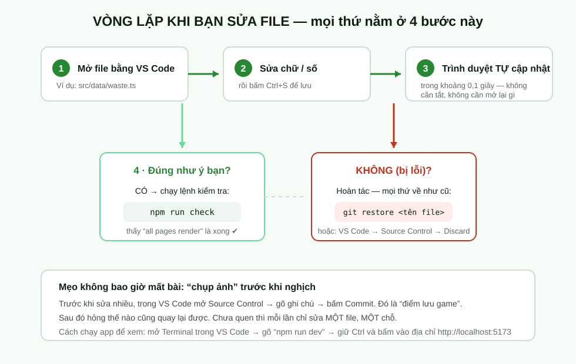
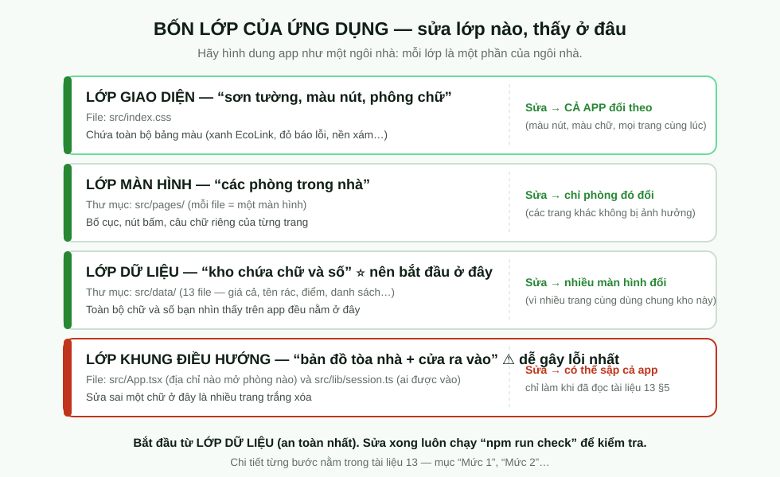
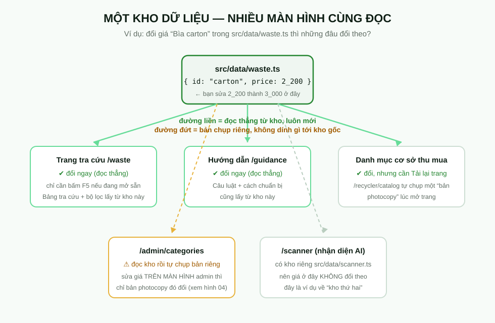
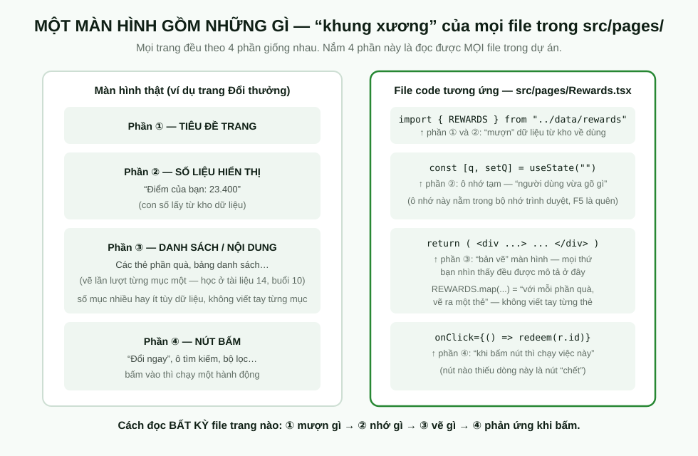
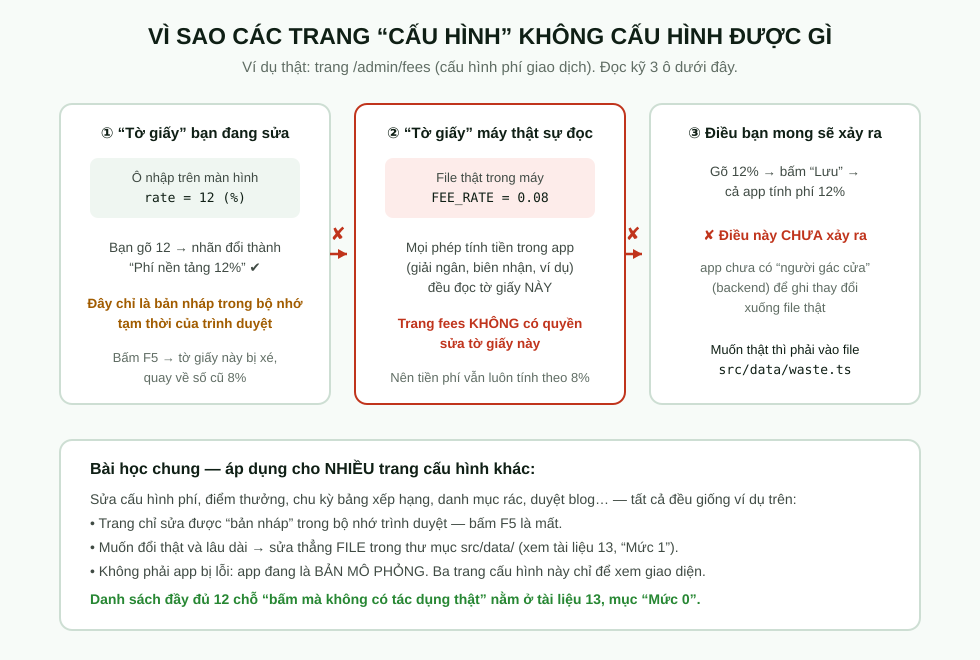
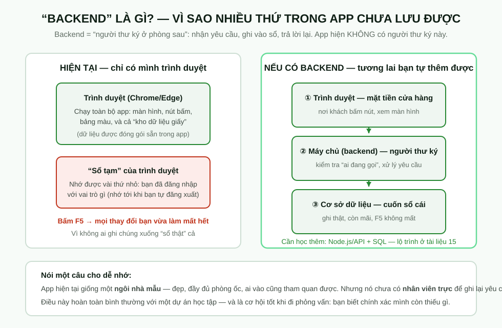

# 13 · Tùy biến: sửa được gì, không sửa được gì — và làm thế nào

> Tài liệu này viết cho người **chưa từng đụng vào code**. Không cần biết thuật ngữ nào trước khi đọc — từ nào lạ sẽ được giải thích ngay tại chỗ (và có "Từ điển" ở §9).
>
> **Cách đọc:** mỗi mục đều theo công thức *Muốn gì → Mở file nào → Đổi chỗ nào → Lưu thế nào → Mở đâu để thấy kết quả*. Bạn có thể vừa đọc vừa làm, sai cũng không sao — §0.4 chỉ bạn cách "undo" (hoàn tác) mọi thứ.

---

## §0. Chuẩn bị trong 10 phút (làm một lần)

### 0.1 Ba cửa sổ bạn sẽ dùng

```
┌─────────────────────────┐   ┌─────────────────────────┐   ┌─────────────────────────┐
│  ① VS CODE              │   │  ② TERMINAL             │   │  ③ TRÌNH DUYỆT          │
│  (trình soạn file)      │   │  (cửa sổ gõ lệnh)       │   │  (Chrome / Edge)        │
│                         │   │                         │   │                         │
│  Xem và sửa file chữ    │   │  Gõ "npm run dev" để    │   │  Mở địa chỉ             │
│  trong thư mục dự án    │   │  "bật" app lên xem      │   │  localhost:5173 để XEM  │
│  (giống Notepad nhưng   │   │                         │   │  app                   │
│  có màu và gợi ý)       │   │  Terminal nằm LUÔN bên  │   │  Đây là nơi bạn kiểm    │
│                         │   │  trong VS Code: menu    │   │  tra mọi thay đổi       │
│                         │   │  Terminal → New Terminal│   │                         │
└─────────────────────────┘   └─────────────────────────┘   └─────────────────────────┘
```

**"File" là gì?** Là một văn bản trên máy — giống file Word, nhưng chỉ có chữ thuần, không in đậm, không màu mè. Cả app này được ghép từ ~90 file chữ như vậy. Bạn sửa chữ trong file = sửa app.

### 0.2 Bật app lên xem (một lần cho cả buổi làm việc)

1. Mở VS Code, mở thư mục dự án `ecolink-web`.
2. Menu **Terminal → New Terminal** (một khung đen hiện ra ở đáy cửa sổ).
3. Gõ đúng dòng này rồi Enter:

```
npm run dev
```

- `npm` = "trình quản lý phần mềm" đi kèm khi bạn cài Node.js. `run dev` = "chạy chế độ xem thử". Bạn sẽ gõ lệnh này mỗi ngày làm việc, không cần hiểu sâu hơn.
4. Chờ vài giây. Khi thấy dòng chữ có `http://localhost:5173` → **giữ phím Ctrl và bấm chuột** vào đó (hoặc tự mở trình duyệt và gõ địa chỉ đó).
5. Xong. Cửa sổ Terminal **để nguyên đó suốt buổi** — nó chính là "máy đang chạy app".

> 🔍 **`localhost:5173` nghĩa là gì?** "localhost" = chính chiếc máy tính của bạn (chưa đưa lên mạng); 5173 là số hiệu "cửa" mà app đang mở. Nó giống như phòng số 5173 trong chính nhà bạn.

Tắt app khi làm xong: bấm chuột vào khung Terminal và nhấn **Ctrl + C**.

### 0.3 Điều kỳ diệu: trình duyệt tự cập nhật — xem hình



Khi bạn bấm **Ctrl + S** để lưu file, app trong trình duyệt **tự đổi theo trong khoảng 0,1 giây** — không cần tắt gì, không cần mở lại gì. Cơ chế này tên là "HMR" (tự làm mới khi bạn lưu). Bạn KHÔNG cần biết thêm gì về nó, chỉ cần nhớ: **sửa → Ctrl+S → liếc qua trình duyệt**.

### 0.4 "Undo" của cả dự án: git và điểm lưu

Dự án này có sẵn hệ thống **git** — hãy hình dung nó là *nút Undo cấp toàn dự án* + *album ảnh lịch sử*:

| Bạn muốn | Làm cách này |
|---|---|
| Hoàn tác **một file** vừa sửa hỏng | Trong VS Code: biểu tượng **Source Control** (hình rẽ nhánh ở cột trái) → tìm file đó → bấm mũi tên ↩ *Discard Changes* |
| Tạo "điểm lưu" trước khi nghịch ngợm | Source Control → gõ ghi chú (ví dụ `truoc khi sua gia`) → bấm **Commit** |
| Xem mình vừa sửa gì | Source Control liệt kê mọi file bị đổi, bấm vào xem từng dòng |

> ⚠️ Nếu bạn dùng **lệnh git trong Terminal**, đừng bao giờ gõ `git restore .` khi chưa chắc — dấu `.` nghĩa là "hoàn tác **mọi** file". Muốn an toàn chỉ hoàn tác một file: `git restore src/data/waste.ts` (thay tên file của bạn).

### 0.5 Nút "kiểm tra sức khỏe" sau mỗi lần sửa

Trong Terminal, gõ:

```
npm run check
```

- `check` = bài kiểm tra tự động **56 phép thử**: nó dựng thử mọi màn hình xem có màn hình nào "vỡ" không.
- Chạy thêm `npm run check:routes` (38 phép thử) — kiểm tra "bảng địa chỉ" của app (xem §5 mới hiểu địa chỉ là gì).
- Kết quả mong đợi: chữ xanh / `OK` toàn bộ. Nếu có chữ **đỏ báo lỗi**, gần 100% là do file bạn vừa sửa — hoàn tác file đó theo §0.4 là xong.

### 0.6 Ba luật vàng khi tự sửa

1. **Mỗi lần chỉ sửa MỘT chỗ.** Sửa 5 chỗ rồi 1 chỗ hỏng = không biết chỗ nào.
2. **Ctrl+S ngay sau khi sửa**, rồi liếc qua trình duyệt.
3. **Chưa chắc thì tạo "điểm lưu" (Commit) trước.** Mất 20 giây, cứu cả buổi.

---

## §1. Bản đồ 4 lớp — chữ trên màn hình "sinh ra" từ đâu



App được ghép từ 4 lớp. Điều quan trọng nhất cần khắc cốt: **hầu hết chữ và số bạn nhìn thấy KHÔNG được viết trong file màn hình, mà nằm trong "kho dữ liệu" ở thư mục `src/data/`.** Sửa kho là nhiều màn hình cùng đổi.

### Bảng tra nhanh: "tôi muốn đổi X → mở file Y"

| Muốn đổi... | Mở file này | Ghi chú |
|---|---|---|
| Giá thu mua một loại rác | `src/data/waste.ts` | Tìm theo tên loại, ví dụ `"Bìa carton"` |
| Tên hoặc câu hướng dẫn xử lý loại rác | `src/data/waste.ts` | Cùng chỗ trên |
| Điểm xếp hạng / điểm tiêu dùng của bạn | `src/data/rewards.ts` | `RANK_POINTS`, `SPEND_POINTS` |
| Tên quà, giá điểm của quà | `src/data/rewards.ts` | Danh sách `REWARDS` |
| Tên các mục menu xanh trên đầu trang web | `src/data/nav.ts` | `NAV_LINKS` (máy tính) và `MOBILE_LINKS` (điện thoại) |
| Các cột chữ ở chân trang (footer) | `src/data/nav.ts` | `FOOTER_COLUMNS` |
| Menu cột trái của khu người dùng / nội bộ | `src/data/portal.ts` | Một chỗ cho cả 4 vai trò |
| Số liệu tổng quan (48.210 người dùng…) | `src/data/ops.ts` | Khối `STATS` |
| Màu xanh thương hiệu, màu chữ, phông chữ | `src/index.css` | Bảng "phân bổ màu" ở đầu file |
| Mật khẩu dùng để đăng nhập thử | `src/components/AuthForm.tsx` | `DEMO_PASS = "123"` |
| Chữ đặc thù chỉ có ở MỘT màn hình | file màn hình đó trong `src/pages/...` | Ví dụ số điện thoại mẫu trong `src/pages/account/Profile.tsx` |

> 🔍 **Vì sao tách "kho dữ liệu" riêng?** Để một loại rác có giá ở đúng một chỗ. Nếu giá "Bìa carton" được chép vào 5 màn hình thì mỗi lần đổi giá phải sửa 5 nơi, quên một nơi là app nói hai kiểu khác nhau. Đây là nguyên tắc "một nguồn sự thật" — và là câu trả lời phỏng vấn rất tốt (xem tài liệu 15).

---

## §2. MỨC 1 — Đổi chữ và số (an toàn nhất, làm được ngay hôm nay)



Khuôn mặt chung của mọi việc ở mức này:

```
Mở file bằng VS Code  →  Ctrl+F tìm chữ cũ  →  sửa thành chữ mới  →  Ctrl+S  →  nhìn trình duyệt
```

### Ví dụ 1 — Đổi giá thu mua "Bìa carton" từ 2.200đ thành 3.000đ

1. Mở file `src/data/waste.ts`.
2. Ctrl+F, gõ `Bìa carton`. Bạn sẽ thấy một "thẻ" như sau (đây là **nguyên văn**):

```ts
  {
    id: "carton",
    name: "Bìa carton",
    group: "Giấy",
    price: 2_200,
    recyclable: true,
    rule: "Thùng carton, hộp giấy, bìa bao bì. Không thu gom giấy ướt.",
    prep: "Bỏ lớp dính và băng keo, gấp phẳng.",
  },
```

3. Sửa dòng `price: 2_200,` thành `price: 3_000,` rồi Ctrl+S.
4. Mở (hoặc bấm F5) trang `/waste` — dòng "Bìa carton" đã hiện giá mới. Các màn hình dùng chung kho này (như `/guidance`, `/recycler/catalog`) cũng đổi theo sau khi mở lại trang.

> 🔍 **Vì sao `2_200` có gạch dưới?** Trong JavaScript/TypeScript, dấu `_` trong số chỉ để người đọc dễ đếm (2_200 = 2200). Máy hiểu y hệt như viết `2200`. Bạn có thể viết `2200` cũng được.
>
> ⚠️ **Đừng bao giờ bọc số vào dấu ngoặc kép.** `price: 3_000` là số; `price: "3_000"` là *chữ* — TypeScript sẽ báo lỗi đỏ vì trường `price` yêu cầu số. (Ngoặc kép dành cho *chữ* như `name`, `rule`.)

### Ví dụ 2 — Đổi điểm xếp hạng của bạn thành 99.999

1. Mở `src/data/rewards.ts`, đầu file có hai dòng này:

```ts
export const RANK_POINTS = 23_400
export const SPEND_POINTS = 12_400
```

2. Sửa `23_400` → `99_999`, Ctrl+S. Xem ở `/account/profile` (mục điểm) và `/rewards`.
3. Thử đổi luôn `TIERS` (ngay dưới đó) — nó là bản chia hạng; bạn sẽ thấy "hạng" của mình nhảy từ *Rừng* lên *Đại dương* nếu vượt ngưỡng 30.000.

> ⚠️ **Hai loại điểm khác nhau, đừng lẫn:** `RANK_POINTS` (điểm xếp hạng, quyết định hạng) và `SPEND_POINTS` (điểm tiêu được để đổi quà). Phần chênh lệch 23.400 − 12.400 = 11.000 là "đã đổi quà rồi". Sửa SPEND cao hơn RANK là dữ liệu vô lý — ví dụ tốt để hiểu vì sao cần quy tắc dữ liệu.

### Ví dụ 3 — Đổi tên mục menu công khai

1. Mở `src/data/nav.ts`:

```ts
export const NAV_LINKS = [
  { to: "/", label: "Tổng quan" },
  { to: "/scanner", label: "Nhận diện AI" },
  { to: "/map", label: "Điểm thu gom" },
  { to: "/partners", label: "Đối tác tái chế" },
  { to: "/rewards", label: "Đổi thưởng" },
  { to: "/blog", label: "Blog" },
] as const
```

2. Sửa `"Đối tác tái chế"` → `"Nhà máy tái chế"`, Ctrl+S, nhìn thanh menu trên đầu trang chủ.
3. Thử thu nhỏ cửa sổ trình duyệt xuống cỡ điện thoại (Ctrl+Shift+M trong Chrome) — tên đó **vẫn như cũ**, vì bản điện thoại đọc danh sách khác (`MOBILE_LINKS`, ngay dưới trong cùng file). Sửa cả hai chỗ nếu muốn đồng bộ.

> 🔍 Đây là bài học lớn của dự án: **cùng một thứ có thể đến từ nhiều nguồn khác nhau**. Khi đổi mà "không thấy gì đổi", hãy tự hỏi: màn hình đó đọc từ nguồn nào? Cuối mỗi tài liệu 03b–11b đều chỉ rõ nguồn dữ liệu của từng màn hình.

### Ví dụ 4 — Đổi số liệu tổng quan khu quản trị

1. Mở `src/data/ops.ts`, tìm `export const STATS = {` (~dòng 330).
2. `users: 48_210` → `users: 60_000`; Ctrl+S; mở `/admin` (đăng nhập vai *Quản trị*, xem §4 để biết tài khoản demo).

### Ví dụ 5 — Đổi mật khẩu đăng nhập thử

1. Mở `src/components/AuthForm.tsx`, tìm `const DEMO_PASS = "123"`.
2. Đổi thành `"ecolink2026"`. Từ giờ đăng nhập demo phải gõ mật khẩu mới. (Đừng quên, không có "quên mật khẩu" thật đâu!)

### Lỗi lặt vặt người mới hay gặp (đọc 1 lần, tiết kiệm 1 giờ)

| Hiện tượng | Nguyên nhân gần như chắc chắn | Cách sửa |
|---|---|---|
| Sửa xong mà app không đổi gì | Quên Ctrl+S (file còn dấu chấm ● trên tab) | Ctrl+S rồi xem lại |
| Lỗi đỏ nói về ngoặc kép/`Unexpected` | Bạn copy chữ từ Word/chat, dấu `"` bị biến thành dấu cong `“ ”` | Xoá, gõ lại dấu `"` thẳng bằng bàn phím |
| Màn hình trắng xoá | Xoá nhầm một dấu `}` hoặc `)` khi sửa | Chạy `npm run check`, hoàn tác file vừa sửa (§0.4) |
| Lỗi đỏ khó hiểu | Chụp màn hình hoặc copy nguyên dòng đỏ — đọc tài liệu này §8, hoặc gửi hỏi | Hoàn tác trước cho chắc |

---

## §3. MỨC 2 — Đổi màu sắc, phông chữ, bề rộng (sửa 1 file, cả app đổi)

Toàn bộ "danh sách màu" của app nằm ở đầu file `src/index.css`, trong khối gọi là `@theme`. Mỗi dòng có chú thích tiếng Việt ngay trong file. Các màu chính:

| Tên trong file | Đang là màu gì | Xuất hiện ở đâu |
|---|---|---|
| `--color-brand` | `#278733` (xanh EcoLink) | Nút chính, chữ nhấn, viền khi bấm vào ô nhập |
| `--color-brand-deep` | `#006516` (xanh đậm hơn) | Khi rê chuột lên nút, chữ nhỏ cần rõ |
| `--color-mint` | `#67dc99` (xanh bạc hà nhạt) | Nền phụ, thẻ nhấn nhẹ |
| `--color-ink` | `#0f1f15` (gần đen, ánh xanh) | Chữ chính |
| `--color-body` | `#404b44` | Chữ đoạn văn |
| `--color-muted` | `#606d64` | Chữ chú thích mờ |
| `--color-page` | `#f7fbf8` (trắng ngả xanh) | Nền toàn app |
| `--color-warn` | `#c0341c` (đỏ gạch) | Cảnh báo, lỗi |
| `--font-sans` | bộ phông "Plus Jakarta Sans" | Chữ toàn app |

### Ví dụ 1 — Đổi màu thương hiệu

Sửa dòng:

```css
  --color-brand: #278733;
```

thành một mã màu khác (ví dụ xanh dương `#0b5cad`) → Ctrl+S → mọi nút xanh trong app đổi màu ngay.

> ⚠️ **Chọn màu xong phải "thử mắt"**: nhiều nút có **chữ trắng** trên nền màu này. Nếu bạn chọn màu quá nhạt, chữ trắng sẽ khó đọc. Ngay trong file, các chú thích ghi tỉ lệ tương phản (ví dụ `white 4.57:1` — mức tối thiểu để đọc tốt là 4.5:1). Cách kiểm nhanh: nhìn nút ngoài trời nắng có đọc được không? Không → chọn màu đậm hơn.
>
> 🔍 Tỉ lệ tương phản là khái niệm **WCAG** (chuẩn để người mắt kém vẫn đọc được). Dự án này chăm chút chuyện đó — nói ra trong phỏng vấn là một điểm cộng thật.

### Ví dụ 2 — Bề rộng trang và bo góc

Tìm trong cùng file:

- `.page` — bề rộng tối đa của nội dung (đang ~1280px). Tăng lên 1400 nếu màn hình rộng mà nội dung "chen chúc".
- `.card` — thẻ trắng bo góc. Đổi số trong `border-radius` để bo tròn hơn hoặc vuông hơn.

### Ví dụ 3 — Phông chữ

`--font-sans` ở đầu file. Đổi sang phông khác cùng dòng "Google Fonts" ở đầu file (nếu không có mạng, app tự dùng phông hệ thống — chữ vẫn hiện bình thường).

---

## §4. MỨC 3 — Thêm một mục mới vào danh sách (copy khối)

Nguyên tắc: **không tự nghĩ ra — copy một thẻ có sẵn rồi sửa ruột.** Giống photocopy một lá đơn rồi điền lại.

### Ví dụ 1 — Thêm loại rác "Vỏ lon nhôm"

Mở `src/data/waste.ts`, copy nguyên khối của "Bìa carton" ở §2, dán xuống dưới nó, rồi sửa phần ruột:

```ts
  {
    id: "lon-nhom",
    name: "Vỏ lon nhôm",
    group: "Kim loại",
    price: 12_000,
    recyclable: true,
    rule: "Lon nước ngọt, lon bia các loại. Bóp dẹp trước khi giao.",
    prep: "Rửa sơ, để ráo, bóp dẹp.",
  },
```

Ctrl+S xong, mở lại `/waste` → có mục mới tinh trong bảng và bộ lọc.

**Ba điều bắt buộc nhớ:**

1. **`id` phải là chữ không dấu, viết liền** (`lon-nhom`) và **không được trùng** với id khác trong cùng danh sách. Hình dung `id` như số căn cước của mục đó.
2. **`group` phải là một trong 6 giá trị đúng chính tả** — nhìn dòng khai báo `WASTE_GROUPS` ngay trên đầu file: `"Nhựa" | "Giấy" | "Kim loại" | "Thủy tinh" | "Điện tử" | "Hữu cơ"`. Gõ sai dấu (ví dụ `"Kim loai"`) là TypeScript báo lỗi đỏ ngay — đây là "phanh an toàn" của TypeScript đang làm việc cho bạn.
3. **Kết thúc mỗi thẻ bằng dấu phẩy `,`** và không xoá dấu `}` của thẻ bên cạnh.

### Ví dụ 2 — Thêm một phần quà đổi thưởng

Mở `src/data/rewards.ts`, tìm `export const REWARDS`, copy một thẻ có sẵn (ví dụ thẻ `coupon10`) và sửa:

```ts
  {
    id: "coupon20",
    name: "Giảm 20% phiếu thu gom",
    desc: "Áp dụng cho một lần thu gom bất kỳ.",
    cost: 9_000,
    stock: 50,
    kind: "discount",
    img: "/assets/rewards/coupon10.jpg",
  },
```

- `cost` = giá điểm; `stock` = số lượng còn lại, `null` nghĩa "không giới hạn".
- `kind` chỉ được là một trong ba chữ: `"discount"`, `"gift"`, `"tree"` (nhìn các thẻ khác để bắt chước).
- `img` là đường dẫn ảnh; chưa có ảnh mới thì **mượn tạm ảnh của quà khác** — vẫn chạy. Ảnh thật nằm trong thư mục `public/assets/rewards/`; muốn thêm ảnh mới, chép file ảnh vào đó rồi đổi `img` thành `/assets/rewards/tên-ảnh.jpg`.

Xem kết quả ở `/rewards` (mở lại trang).

### Ví dụ 3 — Thêm một hồ sơ chờ duyệt (mẫu) cho nhân viên xử lý

Trong `src/data/ops.ts` có các danh sách `APPLICATIONS` (hồ sơ đối tác), `COMPLAINTS` (khiếu nại), `POSTS` (bài blog). Làm y hệt: copy một khối, sửa ruột. Điều thú vị: trường `status` quyết định mục đó **nằm ở cột nào**: đặt `status: "pending"` thì hồ sơ xuất hiện trong hàng đợi "chờ xử lý" và số đếm trên Dashboard quản trị tự tăng (con số đó được tính bằng `filter`, xem tài liệu 11). Đây là ví dụ đẹp cho câu "dữ liệu điều khiển giao diện".

> ⚠ **Đừng thêm dòng vào `cashflow.ts` nếu không hiểu `handover.ts`** — hai file này là hai bản ghi của cùng các giao dịch, lệch nhau sẽ làm trang Đối soát hiện "chênh lệch" (đúng hay sai đều bị báo như nhau). Chi tiết ở tài liệu 11, mục Đối soát.

---

## §5. MỨC 4 — Thêm một màn hình mới + mục menu (công thức 3 bước)

Đây là mức "bắt đầu giống lập trình thật". Làm đúng 3 bước, không bỏ bước nào.

**Thứ cần hiểu trước:** *địa chỉ* (route) là phần sau tên miền, ví dụ trong `localhost:5173/waste` thì `/waste` là địa chỉ. Bảng "địa chỉ nào mở trang nào" nằm ở file `src/App.tsx`.

### Bước 1 — Tạo file trang mới (bằng cách photocopy một trang có sẵn)

1. Trong VS Code, mở thư mục `src/pages/`.
2. Chuột phải file `Guidance.tsx` → **Copy** → dán vào chính thư mục đó → **Paste** → đổi tên file thành `MyPage.tsx` (chuột phải → Rename).
3. Mở `MyPage.tsx`, sửa **phần chữ hiển thị** cho khác đi — trước hết chỉ sửa tiêu đề và vài câu, đừng xoá cấu trúc. (Muốn hiểu cấu trúc bên trong file trang, xem hình dưới và tài liệu 14.)



### Bước 2 — Khai báo địa chỉ trong "bảng địa chỉ" `src/App.tsx`

Mở `src/App.tsx`. Ở gần đầu file có cả loạt dòng `import` như:

```tsx
import Guidance from "@/pages/Guidance"
```

Thêm dòng tương tự cho trang của bạn (đặt cạnh các dòng cùng khu vực):

```tsx
import MyPage from "@/pages/MyPage"
```

Rồi tìm khối các trang công khai (bên trong `<Route element={<Layout />}>`, quanh dòng 80–94):

```tsx
          <Route path="guidance" element={<Guidance />} />
          <Route path="waste" element={<Waste />} />
```

Thêm một dòng cùng dạng (chú ý: **không** gõ dấu `/` đầu):

```tsx
          <Route path="my-page" element={<MyPage />} />
```

Ctrl+S → bây giờ mở địa chỉ `localhost:5173/my-page` là trang mới hiện ra.

### Bước 3 — Thêm "đường vào" trong menu

Mở `src/data/portal.ts`. Muốn mục menu nằm trong khu người dùng thì thêm một dòng vào mục "Khác" của vai trò `user`:

```ts
        { to: "/my-page", label: "Trang của tôi" },
```

Còn muốn nằm trên thanh menu xanh công khai thì thêm vào `NAV_LINKS` trong `src/data/nav.ts` (như §2 ví dụ 3). Mục menu của cả 4 vai trò đều nằm trong `portal.ts` (kể cả staff/admin — khu nội bộ đọc file này).

### Kiểm tra & lỗi thường gặp ở mức 4

| Hiện tượng | Nguyên nhân |
|---|---|
| Mở `/my-page` ra trang 404 | Quên Bước 2, hoặc gõ địa chỉ khác chữ trong `path` |
| Trang hiện nhưng phải gõ tay địa chỉ mới vào được | Quên Bước 3 |
| Trắng trang, Terminal đỏ lòm | Sai dấu trong `App.tsx` — hoàn tác ngay file đó |
| Sửa `App.tsx` xong mọi trang trắng | Chạy `npm run check:routes` để xem nó chỉ đích danh vấn đề |

---

## §6. MỨC 0 — ⚠️ Những thứ TRÔNG như sửa được nhưng thật ra KHÔNG



Đây là phần **quan trọng nhất** của tài liệu, vì nó cứu bạn khỏi cả buổi chiều vô ích.

**Nguyên nhân duy nhất, nói một câu:** app chưa có **backend** (máy chủ + nơi lưu dữ liệu thật). Mọi thứ bạn bấm chỉ nằm trong "trí nhớ tạm" của trình duyệt; bấm F5 là trình duyệt quên sạch, quay về dữ liệu gốc trong file. (Xem hình "backend là gì" — tài liệu 15 có lộ trình học để tự làm phần đó.)

### Bảng 12+ chỗ "bấm mà không có tác dụng thật"

| Màn hình | Bạn làm gì | Thực tế xảy ra | Muốn thật thì sửa ở đâu |
|---|---|---|---|
| `/admin/fees` (Phí giao dịch) | Đổi phí thành 12%, bấm Lưu | Số trên màn hình đổi, nhưng **mọi phép tính tiền vẫn dùng 8%** | Sửa file `src/data/waste.ts` (mục `FEE_RATE`) |
| `/admin/categories` (Danh mục rác) | Sửa giá/vùng một loại rác | Chỉ đổi bản nháp trong phiên; F5 là mất; `/waste` không đổi | Sửa file `src/data/waste.ts` |
| `/admin/policy` (Chính sách phân loại) | Sửa câu luật phân loại, bấm "Lưu" | Báo đã lưu nhưng không ghi được gì lâu dài | Sửa `rule` trong `src/data/waste.ts` |
| `/admin/gamification` (Cấu hình điểm) | Đổi "điểm mỗi kg", ngưỡng hạng | Không nơi nào đọc các số này | `RANK_POINTS`, `TIERS` trong `src/data/rewards.ts` |
| `/admin/leaderboard` (Chu kỳ xếp hạng) | Chọn chu kỳ tuần/tháng | Chỉ đổi chữ; danh sách không đổi theo | (Chưa có cơ chế — phải lập trình thêm) |
| `/admin/blog` (Duyệt bài) | Bấm "Duyệt" một bài | Bài không xuất hiện ở blog công khai `/blog` (blog đọc file khác) | Sửa `src/data/insights.ts`, hoặc phải nối code (xem tài liệu 11b) |
| `/admin/staff` (Tài khoản Staff) | Tạo nhân viên mới, khoá tài khoản | Chỉ trong phiên; F5 là mất; mã nhân viên tự sinh có lỗi trùng | Cần backend thật mới có ý nghĩa |
| `/admin/permissions` (Phân quyền) | Đổi quyền các vai trò | Không ai kiểm tra các ô này khi chạy | Cần backend xác thực; hiện quyền do code cố định |
| `/recycler/requests` | Nhận / từ chối yêu cầu | Trạng thái đổi trong phiên; F5 về như cũ | Cần backend |
| `/user/handover` | Tạo yêu cầu bàn giao | Nhân viên bên kia không nhận được gì (không ai "bên kia" cả) | Cần backend |
| `/chat` | Nhắn tin với người mua | Chỉ là hội thoại mô phỏng; F5 mất | Cần backend |
| `/feedback` | Gửi khiếu nại | Không đến được màn hình khiếu nại của nhân viên | Cần backend |
| `/reset-password` | Nhập email để nhận mã OTP | Không có email nào được gửi — OTP chỉ là chữ trên màn hình | Cần backend + dịch vụ gửi mail |
| `/account/password` | Đổi mật khẩu | Báo thành công; đăng nhập lại vẫn dùng `123` (`DEMO_PASS`) | Sửa `DEMO_PASS` trong `AuthForm.tsx` mới thật đổi |
| `/register` (Đăng ký) | Tạo tài khoản mới | Vào được ngay; nhưng **đăng xuất xong là không đăng nhập lại được** (tài khoản không nằm trong bảng tài khoản demo) | Cần backend |

> 🔍 **Đây là app demo — hành vi này KHÔNG phải lỗi.** Không có backend thì "bấm thử xem giao diện phản ứng thế nào" là cách trình diễn hợp lý, người thiết kế đã cố ý như vậy. Việc của bạn (và của tài liệu này) là **biết rõ chỗ nào thật, chỗ nào kịch bản** — đó cũng chính là điều nhà tuyển dụng mong ở người biết đọc hệ thống.

### Nhóm phụ cần biết: "nút chết" và "mã tự sinh có lỗi"

Hai nhóm lỗi nhỏ khác đã được ghi nhận sẵn trong tài liệu (không cần bạn đi tìm):

1. **Nút chết (thiếu `onClick`)**: một vài nút cuối luồng bấm không có gì xảy ra — "Đổi ngay" trong `/rewards` (trường hợp hết điểm/hết quà), "Gửi đánh giá" trong `/user/receipt`, 5 nút trong `/map` (chỉ đường, gọi điện…). Nguyên nhân: nút thiếu dòng `onClick={...}` — hình 07 phần ④. Cách sửa nằm ở tài liệu 11b §10.3.
2. **Mã tự sinh bằng "độ dài danh sách + 1"**: ở hai trang (`EcoFacts` sinh mã `EF-...`, `StaffAccounts` sinh mã `NV-...`), mã mới = số mục hiện có + 1. Xoá 1 mục rồi thêm mục mới là **hai mục trùng mã**. Cách đúng: đếm theo mã lớn nhất đã từng dùng.

---

## §7. MỨC 5 — KHÔNG sửa được bằng cách sửa file (vì chưa tồn tại)



| Thứ bạn muốn | Vì sao chưa làm được | Cần học gì để làm được (lộ trình ở tài liệu 15) |
|---|---|---|
| Đăng nhập thật, tài khoản thật | Chưa có nơi lưu tài khoản; "phiên đăng nhập" chỉ là một tờ giấy nhớ trong trình duyệt, ai cũng sửa được bằng vài cú bấm | Node.js + API + cơ sở dữ liệu |
| Lưu mọi thay đổi (giá, đơn hàng, tin nhắn…) | Không có "sổ cái" phía sau | Backend + database |
| Gửi email / OTP / quên mật khẩu | Không có ai gửi | Backend + dịch vụ email |
| Thanh toán, tiền thật | Chưa có cổng thanh toán và cũng chưa nên có khi chưa có backend | Cổng thanh toán + bảo mật |
| Nhận diện ảnh bằng AI thật | Trang `/scanner` đang diễn lại kết quả có sẵn để bạn xem giao diện | Một mô hình AI + API |
| Nhiều người thật cùng dùng, thấy nhau | Mỗi trình duyệt là một "thế giới riêng" | Backend + websocket (cho chat) |
| Tải ảnh lên | Chưa có nơi nhận file | Backend + dịch vụ lưu trữ file |

> ⚠️ **Phân quyền hiện tại chỉ là "diễn cho đẹp":** ai biết vài thao tác kỹ thuật đều có thể tự nhận mình là admin. Với app học tập thì bình thường, nhưng **đừng bao giờ** đưa app chưa có backend lên dùng thật với dữ liệu thật.

---

## §8. Sau mỗi lần sửa — quy trình 4 bước (dán lên tường)

```
① Ctrl + S            →  ② liếc trình duyệt (F5 nếu cần)
③ npm run check (+ npm run check:routes)
④ Ổn → Commit (điểm lưu)   |   Hỏng → hoàn tác file vừa sửa (VS Code → Discard)
```

**Ý nghĩa dòng đỏ khi bài kiểm tra hỏng:** gần như luôn nằm ở cuối chuỗi lỗi, có ghi **tên file và số dòng** — mở đúng file đó, hoàn tác theo §0.4. Chưa quen đọc thì chỉ cần làm thế, không cần hiểu chữ tiếng Anh.

**Khi nào cần `npm run build`?** Đây là lệnh "đóng gói bản chạy thật" (không phải bản xem thử). Chỉ chạy khi bạn định đem app đi triển khai/chia sẻ cho người khác. Lúc học và sửa, bạn không cần nó.

**Quy trình đầy đủ một buổi tùy biến lành mạnh:**

```
Commit "điểm lưu" → sửa MỘT chỗ → Ctrl+S → xem trình duyệt → npm run check
   → ổn: Commit "mô tả việc vừa làm" → nghỉ hoặc làm tiếp chỗ khác
```

---

## §9. Từ điển 12 từ sẽ gặp trong tài liệu này

| Từ | Nghĩa dễ hiểu |
|---|---|
| **File** | Một văn bản chữ trên máy. Có đuôi tên: `.tsx`, `.ts`, `.css` là ba loại file của dự án này |
| **Thư mục** | "Ngăn kéo" chứa file. `src/data/` là ngăn kéo chứa kho dữ liệu |
| **Dòng (line)** | Mỗi hàng chữ trong file. Khi báo lỗi, máy chỉ đúng số dòng |
| **Terminal** | Khung gõ lệnh. Trong VS Code: menu Terminal → New Terminal |
| **npm** | Trình quản lý công cụ đi kèm Node.js; "chạy app" = `npm run dev` |
| **Dev server (máy chạy thử)** | Tiến trình giữ cho app "sống" tại `localhost:5173` để bạn xem |
| **Ctrl + S** | Lưu file. **Không lưu thì mọi thứ vô nghĩa** — lỗi số 1 của người mới |
| **HMR (tự cập nhật)** | Cơ chế: Ctrl+S là trình duyệt tự đổi theo, không cần bật lại |
| **Lỗi đỏ (error)** | Chữ đỏ trong Terminal/VS Code khi có gì đó sai cú pháp. Gần như luôn chỉ rõ file + dòng |
| **git / Commit / Restore** | Hệ thống "điểm lưu" + "hoàn tác" của dự án (mục §0.4) |
| **Kiểm tra tự động** | `npm run check` — 56 phép thử dựng mọi màn hình; `npm run check:routes` — 38 phép thử địa chỉ |
| **Build** | Đóng gói bản chạy thật để đem đi triển khai; lúc học chưa cần |

Muốn từ điển sâu hơn (React, TypeScript, component, state…) → **tài liệu 14**, buổi 0.

---

## Tự kiểm tra (làm được, không cần mở lại tài liệu)

1. Mở app bằng `npm run dev`, tìm địa chỉ xuất hiện trong Terminal, mở được nó bằng trình duyệt.
2. Đổi giá "Bìa carton" thành 3.000 và **nhìn thấy kết quả ở `/waste`**.
3. Đổi `RANK_POINTS` thành 99.999, thấy hạng của bạn đổi ở `/rewards`.
4. Đổi tên một mục menu ở `NAV_LINKS`, giải thích vì sao menu điện thoại không đổi theo.
5. Đổi `--color-brand` sang màu bạn thích, Ctrl+S, chỉ ra 3 chỗ trong app đổi màu.
6. Thêm loại rác "Vỏ lon nhôm", chỉ ra 4 màn hình thấy mục mới này.
7. Thêm mục menu "Trang của tôi" + địa chỉ `/my-page` + file `MyPage.tsx` (mức 4, cả 3 bước).
8. Kể tên **3 chỗ** trông như sửa được mà thật ra không, và giải thích bằng một câu vì sao (backend).
9. Chạy `npm run check` khi mọi thứ đang tốt, ghi lại cảm giác "xanh toàn bộ".
10. Cố tình xoá một dấu `}` trong file bất kỳ → xem lỗi đỏ trông thế nào → hoàn tác (§0.4) → xác nhận app trở lại bình thường. **Bài này quan trọng nhất**: nó chứng minh bạn không thể làm hỏng gì vĩnh viễn.

---

*Liên quan: **12** (kiểm thử & màu sắc — nơi các con số 56/38 này được tạo ra) · **14** (học code từ số 0, dùng chính dự án này làm sách) · **15** (phỏng vấn & lộ trình học tiếp để tự làm backend).*
